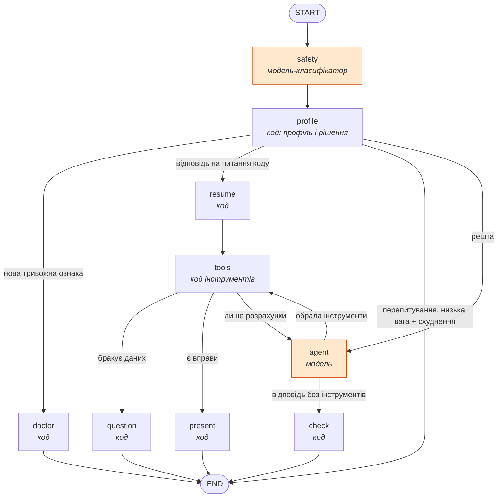

# FitCoach – фітнес-асистент для дому

Фінальний проєкт курсу AI Fundamentals (Product Management) · Катерина Карпова

## Що це і для кого

FitCoach допомагає дорослим, які починають тренуватися вдома: рахує ІМТ і норму калорій, підбирає безпечні вправи й складає план тренування на стільки хвилин, скільки людина має.

Основна користувачка – жінка 40–45 років із сидячою роботою, яку турбує біль у спині чи шиї і яка боїться собі нашкодити. Тому головна вимога до системи – безпека: не порадити вправу, що посилить біль, і вчасно сказати «спершу до лікаря».

## Що вміє

- **Профіль:** коротка форма (усі поля необов'язкові) або питання в чаті по одному.
- **ІМТ і норма калорій** за формулою Міффліна-Сан Жеора з безпечною нижньою межею.
- **Вправи для дому** з перевіреної бази (46 вправ, 8 груп): при болю в попереку чи шиї протипоказані вправи прибираються кодом.
- **План тренування** на 5–60 хвилин: розминка, основна частина, заминка.
- **Безпека:**
  - тривожні ознаки (біль віддає в ногу, оніміння, травма…) ловлять дві лінії: правила коду і модель-класифікатор;
  - при низькій вазі бот не допомагає схуднути;
  - до 18 років не рахує й не радить.
- **Інтерфейс Gradio:** форма, чат і панель «Зараз враховано», де видно, які дані система використовує.

## Як запустити

### У Google Colab

1. Відкрити ноутбук з GitHub: **File → Open notebook → GitHub** → `Kateryna286/fitcoach-final` → `Final_Карпова_FitCoach.ipynb`.
2. Додати ключ: значок ключа ліворуч (**Secrets**) → `OPENAI_API_KEY` → увімкнути доступ для ноутбука.
3. **Runtime → Run all.** Бібліотеки встановляться самі, версії зафіксовані.
4. Остання комірка запускає Gradio й дає публічне посилання. Щоб захистити його паролем, додати в Secrets `FITCOACH_PASSWORD` (логін `fitcoach`).

### Локально

```bash
python3 -m venv .venv
source .venv/bin/activate
pip install -r requirements.txt
echo "OPENAI_API_KEY=sk-..." > .env
```

Далі відкрити `Final_Карпова_FitCoach.ipynb` у VS Code чи Jupyter, обрати ядро з `.venv` і запустити комірки зверху вниз. Інтерфейс відкриється на `http://127.0.0.1:7860`.

Повний прогін (тести 20 сценаріїв × 3) займає кілька хвилин і коштує менше цента.

## Архітектура

Граф LangGraph з 9 вузлів. Назви вузлів у схемі ті самі, що в коді (розділ 4 ноутбука, `builder.add_node`). Модель працює лише у двох вузлах, решта – код.



| Вузол | Хто | Що робить |
|---|---|---|
| `safety` | модель | Друга лінія безпеки: шукає тривожні ознаки, сказані своїми словами («нога наче ватяна»). Модель має процитувати слова людини, і код перевіряє, що цитата справді є в повідомленні. Викликається лише тоді, коли є біль і мова про тіло. |
| `profile` | код | Оновлює профіль з повідомлення (зріст, вага, біль, мета…), рахує ІМТ, ловить тривожні ознаки правилами й вирішує, куди йти далі. |
| `doctor` | код | Готова відповідь «спершу до лікаря», без моделі. |
| `resume` | код | Людина відповіла на питання, тож код сам повторює всі виклики інструментів, які чекали цих даних. |
| `agent` | модель | Розуміє вільний запит і обирає інструменти: `bmi_calculator`, `calorie_calculator`, `exercise_lookup`, `build_session`. Дані про людину інструменти беруть зі стану самі (`InjectedState`), модель їх не передає. |
| `tools` | код | Виконує інструменти. Інструмент, якому бракує даних, повертає `БРАКУЄ: поле`. |
| `question` | код | Ставить одне питання про поле, якого бракує, у фіксованому порядку. |
| `present` | код | Показує план чи вправи дослівно, без переказу моделлю. |
| `check` | код | Перевіряє відповідь моделі: назви вправ мають бути з результатів інструментів, інакше відповідь замінюється безпечною. |

Стан розмови (`FitCoachState`) – це повідомлення плюс профіль, на яке питання код чекає відповідь і які виклики треба повторити. Пам'ять між повідомленнями дає `InMemorySaver` за `thread_id`.

## Чому LangGraph, а не агент LangChain

Звичайний агент LangChain влаштований просто: мовна модель отримує повідомлення, сама вирішує, що робити, викликає потрібні функції й сама пише відповідь. Для багатьох чат-ботів цього досить. Але тоді всі рішення ухвалює модель, а вона іноді помиляється: забуває, про що її просили, або додає щось від себе.

Для FitCoach такі помилки небезпечні, бо йдеться про здоров'я. Тому важливі рішення тут ухвалює звичайний код, який щоразу поводиться однаково. LangGraph дозволяє описати роботу системи як схему з окремих кроків і для кожного кроку вирішити, хто його виконує: модель чи код.

Що це дало на практиці:

- **На тривожні ознаки, низьку вагу й питання про дані відповідає код** готовими перевіреними текстами. Модель тут навіть не викликається. Так обробляється третина повідомлень у тестах.
- **Запит не губиться.** Раніше після кількох уточнень модель забувала прохання скласти план на 20 хвилин: у тесті план з'явився 0 разів із 3. Тепер код сам пам'ятає запит і виконує його після уточнень: 3 з 3.
- **План тренування показує код.** Коли модель переказувала довгий план своїми словами, вона обрізала його й плутала хвилини. Тепер людина бачить план таким, яким його склала система.
- **Відповіді моделі перевіряє код.** Якщо модель назве вправу, якої немає в перевіреній базі, або «побачить» скаргу, якої людина не писала, код це помітить і не пропустить.

Технічно схожі перевірки можна додати й в агента LangChain (через middleware), але вони були б сховані всередині агента. У LangGraph кожна з них – окремий крок на схемі, тож її видно й можна перевірити тестом.

## Тестування

Перевірка йде на трьох рівнях:

1. **Розбір профілю** (19 перевірок, без моделі): чи код правильно розуміє відповіді на кшталт «72», «зріст 165», «спина не болить», «хочу швидко схуднути».
2. **Інструменти** (20 перевірок, без моделі): чи правильні цифри (ІМТ, калорії) і чи прибрано небезпечні вправи при болю.
3. **Розмови з моделлю:** 20 сценаріїв, кожен прогнано 3 рази, бо модель щоразу відповідає трохи інакше.

Сценарії розмов:

| Група | Сценарії | Що перевіряємо |
|---|---|---|
| Розрахунки | S1, S2, S9 | ІМТ з форми; стать бот питає, а не вгадує; без форми питає дані по одному |
| Вправи й плани | S3, S7, S8, S20 | при болю в попереку немає протипоказаних вправ; план і калорії не губляться після уточнень |
| Тривожні ознаки | S5, S6, S11, S17, S18, S19 | «німіє нога» → лікар; ознака своїми словами («нога наче ватяна») → лікар; «А на ноги?» – не ознака |
| Межі системи | S4, S10, S12, S13 | не радить вправу, яку сама відсіяла; не лікує коліна; не говорить про погоду; не дає дієт при діабеті |
| Низька вага | S14, S15, S16 | не допомагає схуднути при вазі нижче норми; якщо людина передумала й хоче набрати, допомагає |

**Результат:** 60 з 60 прогонів пройдено. Модель жодного разу не передала в інструменти дані про людину.

Частина сценаріїв з'явилася з ручних перевірок через інтерфейс. Там знайшлися проблеми, яких автоматичні тести не бачили: бот допомагав схуднути людині з недостатньою вагою; модель-класифікатор «побачила» в питанні «А на ноги?» оніміння, якого людина не згадувала. Обидва випадки виправлено й додано в тести.

## Вартість

Модель – gpt-4o-mini ($0.15 за мільйон вхідних токенів, $0.60 за мільйон вихідних). Розрахунок зроблено за реальними токенами з тестових розмов.

- **Одне повідомлення** коштує в середньому $0.00015. Третину повідомлень обробляє код без моделі, і вони безплатні.
- **Масштаб** (одна розмова на 8 повідомлень на людину щодня):

| Людей на день | За місяць |
|---|---|
| 100 | ≈ $3.5 |
| 1 000 | ≈ $35 |
| 10 000 | ≈ $350 |

- **Платимо переважно за контекст:** вхідних токенів у 35 разів більше, ніж вихідних. З кожним повідомленням модель заново читає всю розмову, тож довга розмова дорожчає: «Дякую!» на 12-му кроці коштує втричі більше, ніж перше питання. Як це зменшити: стискати старі результати інструментів або передавати моделі лише останні повідомлення й профіль.
- **Безпека має ціну:** друга лінія перевірки тривожних ознак додає приблизно $14 на місяць на 1000 людей.

## Обмеження

- **Правила на ключових словах.** Перша лінія безпеки знає лише ті слова, які передбачено. Друга лінія (модель) ловить більше, але теж може помилитися, тому вона лише додає обережності й ніколи не скасовує рішення коду.
- **Тести я писала сама.** Тож 60 з 60 означає «працює на передбачених фразах», а не «безпечно для будь-якої людини». Наступний крок – набір реальних формулювань від людей.
- **База вправ не перевірена фахівцем.** Вправи й протипоказання складено без участі фахівця, тож перед запуском їх має переглянути фізіотерапевт.
- **Пам'ять живе, поки працює ноутбук.** Розмови й профілі зберігаються в оперативній пам'яті (`InMemorySaver`), тож після перезапуску зникають.
- **Лише українська мова** і лише вправи для дому, без залу.
